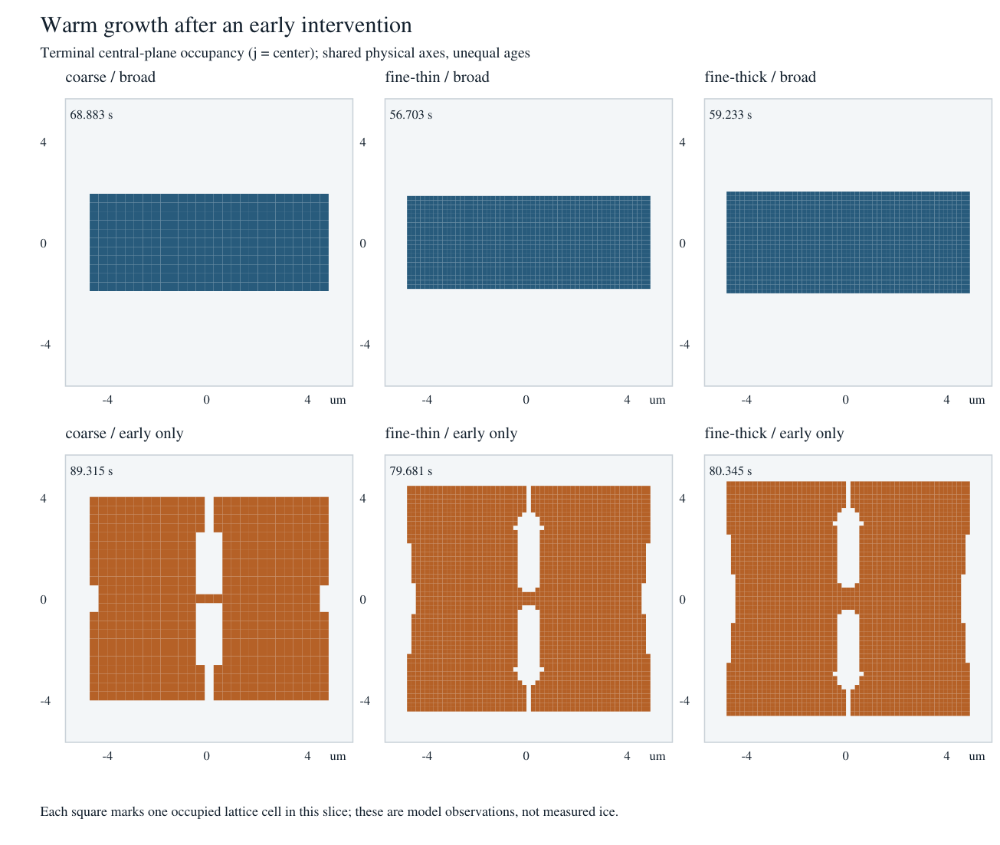

# Warm early-growth memory survives the first representation comparison

All six registered rows are complete, with checked size endpoints and no operational errors.
The early-only intervention retains deepening, axially open structure in all three registered
grid/seed configurations. Their broad controls produce temporary surface openings with zero
tip advance and zero depth. This strengthens a distinct implemented-model history lead; it
does not establish a molecular width law, continuum convergence or physical SDAK.

The sources, exact input hashes, definitions, selections, adjacent-event alternatives and
contrasts are in `inputs.json` and `summary.json`. Full reconstruction is retained in task
`out/analysis-2026-10-21/warm/`, not added as a bulk Git payload.

## Same physical size and common age

At the exact 9.8 um largest lattice-coordinate center span, terminal ages differ:

| Configuration | Broad / early age (s) | Broad / early axial center span (um) | Broad / early open-envelope depth (um) | Broad / early added full-probe waist thickness (um) |
|---|---:|---:|---:|---:|
| Coarse | 68.8833 / 89.3148 | 3.50 / 7.70 | 0 / 3.50 | 3.50 / 0 |
| Fine thin | 56.7035 / 79.6811 | 3.50 / 8.75 | 0 / 4.025 | 3.50 / 0.35 |
| Fine thick | 59.2332 / 80.3447 | 3.85 / 9.10 | 0 / 4.025 | 3.50 / 0.35 |

At the single shared age 56.70347153158861 s, early open-envelope depths are
3.15 / 3.675 / 3.675 um; all three broad depths are zero. These depth values also hold
at the next-event alternatives. At this age the early-minus-broad axial center-span
differences are 3.50 / 4.55 / 4.55 um, also unchanged by those adjacent-event alternatives.
No occupancy interpolation is used.

The within-pair minimum terminal ages are separately 68.8832798712082,
56.70347153158861 and 59.23322494643029 s. At those pair-specific ages the same early-minus-broad
axial differences and depths hold; `pairs[].commonAges` retains every selected quarter age
and each row's actual sampling bracket. Pair-specific ages are not a cross-grid common age.

The two fine early rows have the same added axial span (8.75 um after subtracting their
different initial axial spans), the same depth and the same added waist thickness at the
terminal size. This is agreement over the two tested initial thicknesses, not seed independence.
The 0 versus 0.35 um added waist and the 3.50 versus 4.025 um depths still differ across the
coarse/fine configurations. Changed age, seed voxelization and spacing preclude calling their
difference a pure grid-error estimate. The first representation challenge survives; physical
length convergence remains unresolved.



## The structure keeps advancing after the intervention ends

The coupled-update convention is retained: an update starting before 20 s finishes unchanged,
then the following update uses broad basal kinetics. Actual switches are 20.0484056934,
20.0065589354 and 20.0239339328 s for coarse / fine thin / fine thick.

| Configuration | Signed plane/side intervals open at switch, surviving to stop | New post-switch intervals, surviving to stop | Maximum post-switch tip advance while an original plane remains open (um) | Total axial center-span growth after switch (um) |
|---|---:|---:|---:|---:|
| Coarse | 14 / 14 | 8 / 8 | 1.40 | 2.80 |
| Fine thin | 32 / 32 | 16 / 16 | 1.225 | 2.45 |
| Fine thick | 32 / 32 | 16 / 16 | 1.225 | 2.45 |

Some newly created post-switch intervals also advance: their maximum post-switch tip advances
are 1.05 / 1.225 / 1.225 um. Thus the evidence exceeds an unchanged opening merely remaining
visible. These signed intervals are not independent cavities; continuous plane/side witnesses
do not identify complete three-dimensional cavity components. A null interval end means open
through the recorded stop, not indefinitely.

Every early row records zero selected basal cell-updates and zero selected kinetic demand
after switching off. Before switching off, selected basal demand fractions are about
99.343% / 99.840% / 99.839%. The intervention initially selects most basal demand; it must not
be described as a measured rim-only law or isolated molecular narrow-facet physics. The result
is persistence of inherited geometry/evolution state under subsequently broad kinetics.

## What this decides and what remains open

The warm lead is no longer supported only by the coarse representation or a lone terminal
opening. It has matched controls, common-age brackets, a matched-size comparison, two finer
seed representations, and witnessed new growth after the preparation is removed. This is
useful development evidence under ADRs 0058/0059/0062.

The registered 0.35 um central probe is one coarse radial cell or two fine radial cells.
Its full-waist thickness is a discrete occupancy measure, not deposited ice mass. The shared
shell coordinate length does not demonstrate domain independence. Two spacings and two
thickness brackets do not bound nonlinear results or determine a convergence order. The
opening witness is sufficient for a straight axial escape path, not a complete closure test.
Sparse field samples cannot establish the cause of opening onset. No automatic five-arm
width-three verdict is used for these width-six fine pairs. Phase 7 remains separate.

No further warm launch is selected here. A lower-cost next option is a deliberately costed
half-timestep coarse early/broad pair to test whether these history/depth observations depend
on fill increments; it would not qualify the finer rows. A further spatial-resolution or
width-rule comparison could address physical-length sensitivity, but needs its own protocol,
resource/restart review and honest multi-day cost before selection. First use this completed
comparison alongside the other portfolio results rather than expand warm cases automatically.

## Reproduction and review limits

From the task repository root, use a fresh bulk and evidence output directory:

```powershell
node evidence/hil-results-review-2026-10-21/warm/analyze.mjs C:/Users/biao3/.codex/worktrees/hil-warm-refinement/snowflake/out/warm-refinement-hil out/warm-review-replay out/warm-review-replay/concise
node evidence/hil-results-review-2026-10-21/warm/render-slices.mjs C:/Users/biao3/.codex/worktrees/hil-warm-refinement/snowflake/out/warm-refinement-hil out/warm-review-replay/terminal-slices.svg
```

The unchanged analyzer is `post-phase10-cavity-analysis.ts`, with its existing geometry/spatial
functions. The first executed all-six CLI readout was supplied explicitly as the recipe's optional
fourth argument when packaging this result, then all three pair readouts were executed. The
analyzer/geometry/spatial source diff against producer 838c294 is empty. No solver simulation,
live mutation, new metric library, scientific gate or independent physical validation occurred.
Codex/GPT-6 with inherited context performed the analysis and a proportionate skeptical pass;
the original registered design was shared context. Root owns stable-checkpoint repository
verification and governed NAS preservation. This note does not certify either action.
